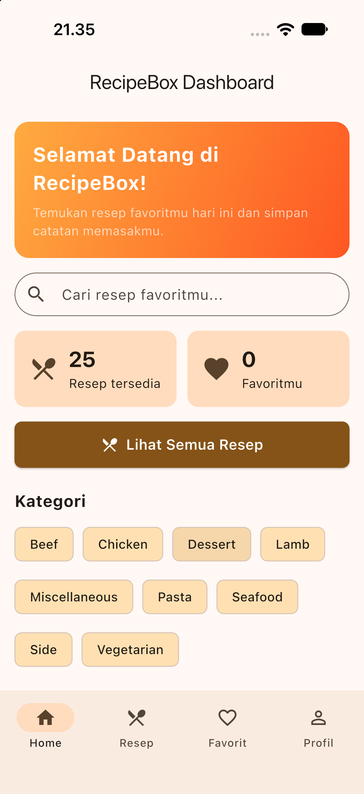
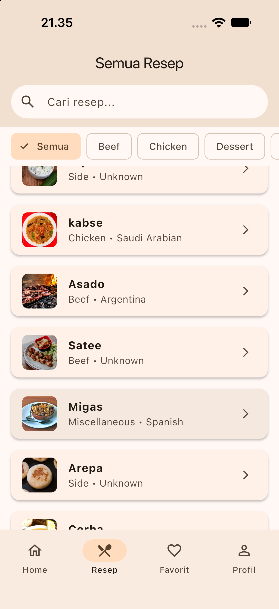
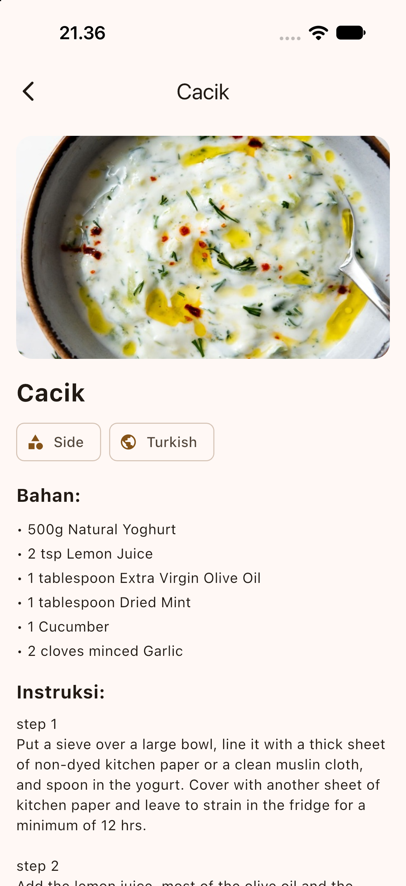
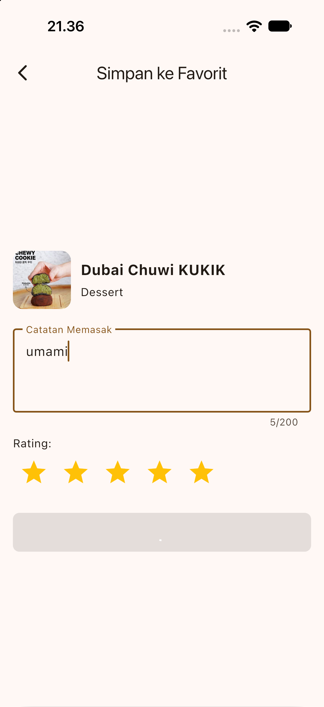
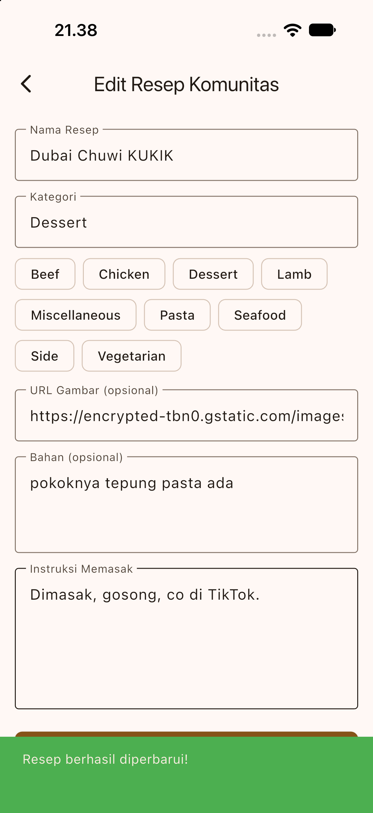
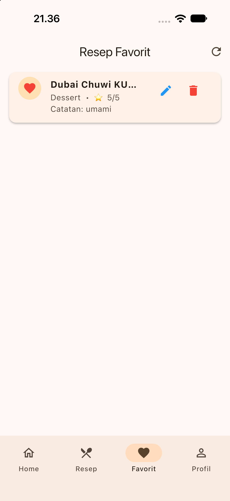
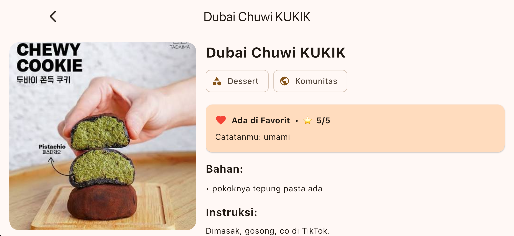
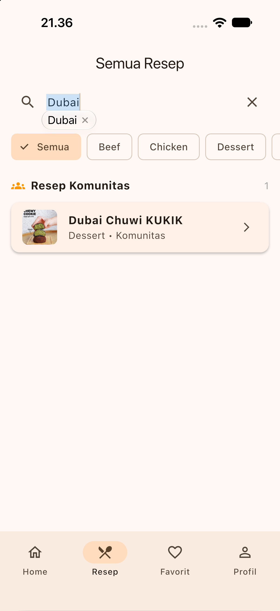
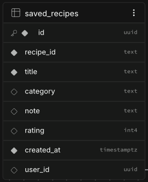

# RecipeBox

Aplikasi mobile Flutter untuk mencari resep makanan dan menyimpan resep favorit
beserta catatan memasak dan rating pribadi. Katalog resep diambil dari **REST API
TheMealDB**, sedangkan data personal (favorit, catatan, rating) disimpan di
**database Supabase**.

## Identitas

| | |
|---|---|
| Nama | Ketut Rona Dino |
| NIM | 2415051108 |
| Kelas | Pemrograman Mobile |
| Mata kuliah | Pemrograman Mobile – Project UTS |
| Repository | [https://github.com/ketutronadino-wq/UTS_2415051108_Ketut-Rona-Dino.git](https://github.com/ketutronadino-wq/UTS_2415051108_Ketut-Rona-Dino.git) |

## Fitur

- Dashboard: ringkasan jumlah resep & favorit, pencarian cepat, kategori, rekomendasi resep
- Daftar resep dari REST API (list di layar sempit, grid di layar lebar) dengan pull-to-refresh
- Pencarian resep berdasarkan nama dan filter berdasarkan kategori
- Detail resep: gambar, bahan, instruksi, layout 2 kolom di layar lebar
- **Create** – simpan resep ke favorit lewat form (catatan + rating) dengan validasi
- **Read** – daftar resep favorit dari database
- **Update** – edit catatan dan rating
- **Delete** – hapus favorit dengan dialog konfirmasi
- Loading, error (dengan tombol "Coba Lagi"), dan empty state di setiap daftar
- SnackBar / AlertDialog sebagai umpan balik operasi penting
- Navigasi adaptif: NavigationBar (compact) dan NavigationRail (wide)

## Tech Stack

- Flutter & Dart (Material 3)
- Provider + ChangeNotifier (state management)
- `http` (REST API), `supabase_flutter` (database)

## REST API

[TheMealDB](https://www.themealdb.com/api.php) – `GET https://www.themealdb.com/api/json/v1/1/search.php?s=a`
Response JSON dikonversi menjadi `RecipeModel`.

## Backend / Database

Supabase (PostgreSQL), tabel `saved_recipes`:

| Kolom | Tipe | Keterangan |
|---|---|---|
| id | uuid (PK) | primary key |
| recipe_id | text | id resep dari TheMealDB |
| title | text | nama resep |
| category | text | kategori resep |
| note | text | catatan pengguna |
| rating | int | 0–5 |
| created_at | timestamptz | waktu dibuat |

Skrip pembuatan tabel dan RLS ada di [`supabase_setup.sql`](supabase_setup.sql).
Aplikasi hanya memakai **anon key**; `service_role` key tidak pernah dipakai maupun di-commit.

## Arsitektur

## Screenshot

*(Pastikan gambar sudah ada di folder `screenshots/`)*
| Home | List | Detail |
|---|---|---|
|  |  |  |

| Create | Edit | Favorit |
|---|---|---|
|  |  |  |

| Responsive (wide) | Data API | Data Database |
|---|---|---|
|  |  |  |

## Cara Menjalankan

```bash
git clone https://github.com/ketutronadino-wq/UTS_2415051108_Ketut-Rona-Dino.git
cd UTS_2415051108_Ketut-Rona-Dino
flutter pub get
flutter run


---

### 🛠️ Perbaikan 4: GAGAL - Mengambil Screenshot

Skrip membutuhkan 9 file gambar di dalam folder `screenshots/`. Jika Anda belum membuat folder ini, buat sekarang di folder utama project (sejajar `lib`).

Ambil *screenshot* dari HP/Emulator Anda, lalu masukkan ke folder tersebut dengan nama **persis** seperti ini:
1.  `home.png` (Halaman Home)
2.  `list.png` (Halaman Daftar Resep)
3.  `detail.png` (Halaman Detail Resep)
4.  `create.png` (Form Simpan ke Favorit)
5.  `edit.png` (Form Edit Catatan)
6.  `favorites.png` (Halaman Favorit)
7.  `wide.png` (Halaman Resep saat HP diputar *Landscape* atau di Tablet)
8.  `api.png` (Bisa pakai screenshot List Resep yang ada data API-nya)
9.  `database.png` (Screenshot Tabel `saved_recipes` di website Supabase)

---

### 🛠️ Perbaikan 5: Membersihkan Warning (Garis Kuning)

Ini tidak wajib, tapi bikin kode Anda lebih profesional.

**A. File `lib/screens/profile_screen.dart` (Baris 58 & 60)**
Cari baris yang ada tulisan `const` di dalam widget `_InfoRow` atau `Row`, lalu hapus kata `const`-nya.

**B. File `lib/services/notification_service.dart`**
VS Code memberi tahu bahwa `getToken` dan `onTokenRefresh` sudah *deprecated* (usang) di Firebase versi baru. Abaikan saja peringatan ini, karena kode Anda **tetap berjalan dengan normal** dan aman untuk dikumpulkan. Jika Anda ingin menghilangkannya, Anda bisa menambahkan komentar `// ignore: deprecated_member_use` di atas baris tersebut.

---

### 🚀 Langkah Terakhir: Uji Ulang & Commit

Setelah semua langkah di atas selesai, jalankan lagi skrip pemeriksanya:
```bash
dart run tool/check_submission.dart